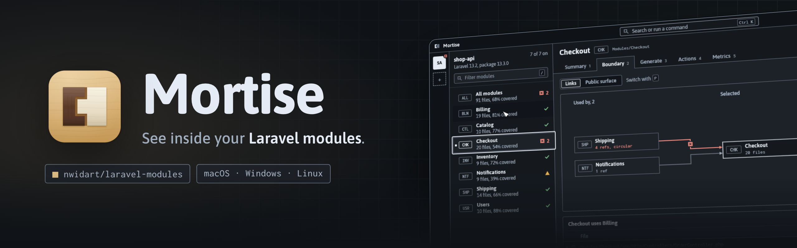
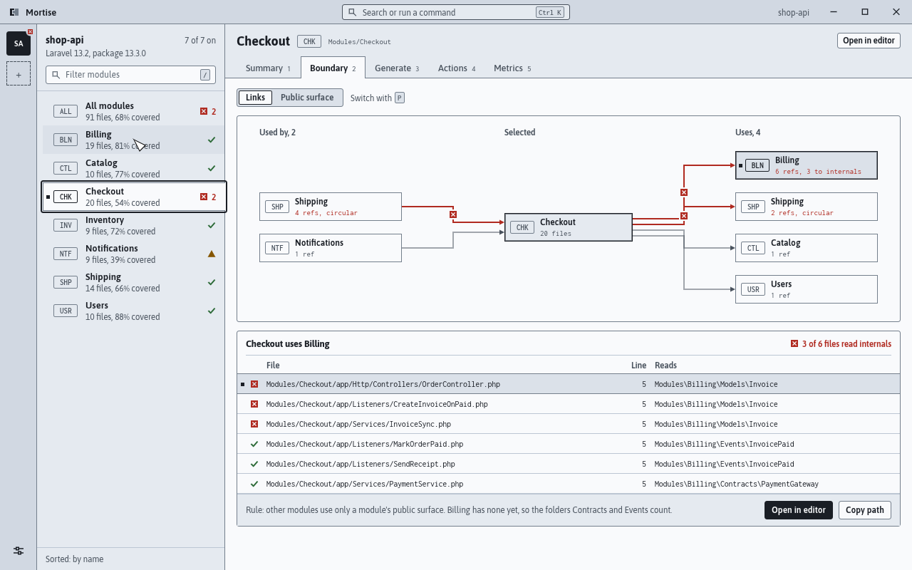

<p align="center">
  
</p>

<p align="center">
  <a href="https://github.com/nWidart/mortise/actions/workflows/ci.yml"></a>
  <a href="https://github.com/nWidart/mortise/releases/latest"></a>
  
  <a href="LICENSE"></a>
</p>

<p align="center">
  <b>A desktop companion for developers who build Laravel apps with
  <a href="https://github.com/nWidart/laravel-modules"><code>nwidart/laravel-modules</code></a>.</b><br>
  Open an app, see every module, which module uses which, and what breaks your rules.<br>
  Then run the package's commands, with the exact command on screen first.
</p>

<p align="center">
  <a href="https://github.com/nWidart/mortise/releases/latest"><b>Download</b></a> &middot;
  <a href="https://nwidart.github.io/mortise/"><b>Documentation</b></a> &middot;
  <a href="#what-it-does">What it does</a> &middot;
  <a href="#run">Build from source</a>
</p>

<picture>
  <source media="(prefers-color-scheme: dark)" srcset="crates/mortise-app/tests/snapshots/s5.1-boundary-module-dark.png">
  
</picture>

## Why Mortise

Mortise opens the folder of an app, lists its modules, and shows what is in each one.
To read an app, Mortise uses no PHP and changes nothing in it. It runs a package command in the
app only when you start it, with the exact command on screen first, through the PHP you chose
for the app: Herd, Sail, Docker or a command of your own. Sail is off on Windows, where it runs
in WSL only; a Custom command is the way there.

When the app also has [`nwidart/laravel-actuator`](https://github.com/nWidart/laravel-actuator)
and is running, Mortise can ask it for its runtime status, its routes, its scheduled tasks and its
metrics. This is optional. Mortise asks for the actuator base path, `health`, `info`, `mappings`,
`scheduledtasks` and `prometheus` only. It never asks for `env` and follows no redirect.
A token or a password goes to the credential store of the operating system and is never written
to a file.

Status: phase 1 (read only), phase 2 (running the package's commands) and phase 3 (the running app, per
module) are built. The plans are `docs/plan/phase-1.md`, `docs/plan/phase-2.md` and
`docs/plan/phase-3.md`. The plan for phase 4 is `docs/plan/phase-4.md`. Where the build differs from
the specification is in `docs/deviations.md`.

## What it does

- Lists the modules of an app with their state, files, lines, kinds, tests and coverage.
- Shows which module uses which, from the PHP source, and finds circular use.
- Checks two rules, kept in `mortise.json` in the app folder so that a team shares them.
  The command line tool `mortise check` checks the same rules in CI (see "Check the rules in CI" below).
- Lists findings: what breaks a rule or a check, each where it lives.
- Scans a module and proposes its public surface. The scan writes nothing.
- With `nwidart/laravel-actuator`: runtime status, routes by module, scheduled tasks and metrics
  (see "The running app" below).
- Runs the package's commands, each one only when you start it:
  - The runner drawer shows the output as written, with Stop and a time limit. Mortise keeps
    the last 50 runs of each app in its own data folder, not in the app.
  - The Actions tab turns a module on or off, migrates, rolls back, seeds and checks
    translations. Reset, refresh, drop all tables and delete module sit in a closed group,
    and each asks first. When the app reports the environment `production`, they do not run:
    Mortise only copies the command.
  - The Generate tab offers the 42 generators of `nwidart/laravel-modules` 13.3, New module
    among them. It shows the command, and after the run the files the command wrote. Replace
    runs a generator again over a file or a module that exists, after a question.
  - The palette lists actions and generators, and your recent runs.
- Closing Mortise stops every run and waits up to 5 seconds for each to end. On Windows, the
  PHP child of a launcher such as `herd.bat` that already exited goes on (`docs/deviations.md`, S53).

An app with `nwidart/laravel-modules` 13.4 or later gets more from the package:

- The Generate tab reads the list of generators from the app, so it shows what that version has.
- "List files" runs a generator as a dry run and shows the files it would write. The result of a
  run comes from the package's answer.
- The Actions tab and the Summary show the migration state after you press "Read migration state":
  waiting and ran migrations, the last batch and the tables a reset drops.
  Mortise reads it again after a migrate, roll back, reset, refresh or fresh.
- Run tests runs `module:test`, with a filter and a parallel option, and the toast counts the tests.
- Findings lists translation keys a language lacks, after Check translations, and the work to do,
  such as waiting migrations. The work to do is not counted as findings.

An older package keeps the earlier behaviour: the 13.3 list of generators, the file list after a run,
no migration state, and Run tests off until the package has the command. The tabs say so where they
leave something out.

The only file Mortise writes in an app is `mortise.json`, and it asks before it creates it.
The package's commands write the other files. Mortise never writes them.

## The running app

Phase 3 reads the running app per module, over HTTP, from the actuator of the environment you
choose. It needs no PHP and writes nothing.

- Runtime status per module. The index marks each module by the worst of its own health
  indicators: Down, Out of service, Up or Unknown. The Summary of a module has a runtime box with
  those indicators and their detail. A module with no indicator of its own has no mark and no box.
- The Metrics tab. It shows requests, response time, errors, jobs and database time for each
  module, read from the `prometheus` endpoint every 15 s while the tab is open and the window is
  visible. The ranges are 15 minutes, 1 hour and 24 hours. Select a module to see its routes.
  The reads stay in memory and are never written to disk.
- Scheduled tasks are listed in the module that declares their command.

An app needs this setup:

- `nwidart/laravel-modules` 13.4 or later. It gives each module its health indicators, named
  `module:{lower case name}:{key}`.
- `nwidart/laravel-actuator` 1.3 or later, with `prometheus` in `exposure.include` in
  `config/actuator.php`, next to `health`. Mortise reads `health`, `info`, `mappings`,
  `scheduledtasks` and `prometheus`.
- `nwidart/laravel-metrics`, with `METRICS_ENABLED=true` and a store such as
  `METRICS_STORE=cache`.
- An environment in Settings: a name, the base URL of the app, the actuator path, and the
  credentials if the actuator needs them (none, a bearer token, HTTP basic or a custom header).
  A secret goes to the credential store of the operating system.

`crates/mortise-core/fixtures/actuator/README.md` lists the versions and the commands of the app that
the recorded answers come from. `tools/real-actuator-app.sh` builds such an app.

Database time reads "unknown" until `nwidart/laravel-modules` labels database metrics with the
module. A series without a `module` label is placed by its route or job class; one that matches
no module counts as "Not in a module" (`docs/deviations.md`, S66).

## Check the rules in CI

`mortise check` reads an app as the window does, runs no PHP and writes nothing. It prints each
problem with its file and line and exits 1 when a rule breaks.

```
mortise check /path/to/laravel-app --format github
```

In GitHub Actions, the action [`nwidart/setup-mortise`](https://github.com/nWidart/setup-mortise) puts
the tool on `PATH` in a few seconds, with no Rust toolchain:

```yaml
- uses: actions/checkout@v5
- uses: nwidart/setup-mortise@v1
- run: mortise check . --format github
```

"Install" below has the other ways to get the tool.

`--format` is `text` (the default), `json` or `github`, whose lines GitHub marks in the pull request.
The exit codes are 0 (no problem), 1 (a problem), 2 (a wrong command line), 3 (the folder is not an
app) and 5 (the report could not be written). `"ci": { "fail": false }` in `mortise.json`, the switch "Fail CI when a rule breaks" in the
window, makes it report without failing. `"coverage": { "limit": 70, "report": "build/clover.xml" }`
sets the coverage of the app for the window and the tool; the flags `--coverage-limit` and
`--coverage` win over it. The [documentation](https://nwidart.github.io/mortise/reference/command-line/)
has the rest.

## Send a read to Mortise Cloud

`mortise push` sends one read of the app to [Mortise Cloud](https://mortisecloud.com), the paid
service that keeps the history of reads and compares a pull request with its base. Mortise itself
judges one commit; the cloud does what spans commits.

```
MORTISE_TOKEN=... mortise push /path/to/laravel-app
mortise push /path/to/laravel-app --dry-run
```

The token comes from `MORTISE_TOKEN` only and is never printed. `--dry-run` prints the document
and sends nothing; it needs no token. On GitHub Actions the pull request and the run come from the
environment, and the commit is the one checked out. An outage of the cloud never fails the build:
the tool warns and exits 0. A refused token or document exits 4. The
[how-to](https://nwidart.github.io/mortise/how-to/send-to-mortise-cloud/) has a workflow.

## Install

Each [release](https://github.com/nWidart/mortise/releases/latest) has:

| Platform | File |
|---|---|
| macOS, Apple silicon | `Mortise-macos-arm64.dmg`. Signed with a Developer ID and notarized by Apple. |
| Windows, x64 | `Mortise-windows-x64-setup.exe`. Not signed: SmartScreen warns once. Choose More info, then Run anyway. |
| Linux, x86_64 | `Mortise-linux-x86_64.AppImage`, or `Mortise-linux-amd64.deb` for Debian and Ubuntu. Not signed. |

Each release also has the command line tool, binary `mortise`, as one archive per platform:

| Platform | File |
|---|---|
| Linux, x86_64 | `mortise-vX.Y.Z-linux-x86_64.tar.gz`. Static (musl): it runs on any Linux. Not signed. |
| Linux, arm64 | `mortise-vX.Y.Z-linux-arm64.tar.gz`. Static (musl). Not signed. |
| macOS, Apple silicon | `mortise-vX.Y.Z-macos-arm64.zip`. Signed with a Developer ID and notarized by Apple. |
| Windows, x64 | `mortise-vX.Y.Z-windows-x64.zip`. Not signed. |

`Mortise-vX.Y.Z-SHA256SUMS.txt` holds the SHA-256 of each file.

The tool also installs from crates.io, on any platform with a Rust toolchain:

```
cargo install --locked mortise-cli
```

## Run

```
cargo run -p mortise-app -- /path/to/laravel-app
cargo run -p mortise-cli -- check /path/to/laravel-app
```

The first runs the window, binary `mortise-desktop`. The second runs the command line tool, binary
`mortise`. Rust 1.99 is needed; `rust-toolchain.toml` selects it.

Mortise keeps its settings in `settings.json` in the config folder of the platform.
`MORTISE_CONFIG_DIR` names another folder. The history of runs lives in the data folder;
`MORTISE_DATA_DIR` names another one. `MORTISE_SECRETS=memory` keeps secrets out of
the credential store, for work on Mortise itself.

## Test

```
cargo test --workspace
```

| Tests | Check |
|---|---|
| `crates/mortise-core/tests` | Reading an app, git, the file watcher, the actuator client against a local stub, the public surface scan |
| `crates/mortise-app/tests` | The interface, run headless and asked by role and name, as a screen reader would |
| `crates/mortise-cli/tests` | `mortise check` on the fixture shop-api: its exit codes and its three formats. `mortise push` against a local stub of the cloud |
| `crates/mortise-core/tests/push.rs` | The push document of shop-api against a committed file and the cloud's JSON Schema |
| `crates/mortise-app/tests/images.rs` | The screens in both themes against the images in `tests/snapshots`. macOS only |
| `crates/mortise-app/tests/accessibility.rs` | Every control has a name and a target of 24 by 24 px |
| `crates/mortise-core/tests/real_php.rs` | The package's commands in a real Laravel app. Ignored by default; a CI job that is not required runs them (see `AGENTS.md`) |
| `crates/mortise-core/tests/real_actuator.rs` | The actuator client against a real app with the actuator and metrics. Ignored by default; a CI job that is not required runs them (see `AGENTS.md`) |

After a change that is meant to be seen, make the images again and look at what changed:

```
UPDATE_SNAPSHOTS=1 cargo test -p mortise-app --test images
```

`cargo test -p mortise-app --test screens -- --ignored` writes every screen to
`target/screens`, to be looked at beside the drawings in `docs/spec`.

## Layout

| Path | Holds |
|---|---|
| `crates/mortise-core` | Everything that is not drawing: reading an app into a snapshot, the actuator client, the scan. No interface dependency. |
| `crates/mortise-app` | The window, built with egui and eframe. Binary `mortise-desktop`; the installers and the app are named Mortise. |
| `crates/mortise-cli` | The command line tool, binary `mortise`: `mortise check` and `mortise push`. It uses `mortise-core` without its default features. |
| `assets/brand` | The README banner and the social preview, drawn from HTML by `tools/brand-images.sh`. |
| `assets/fonts` | Asap and Inconsolata, each with its `OFL.txt`. |
| `assets/icon` | The app icon: two drawings, `mortise.svg` and `mortise-16.svg`, and the files made from them for macOS (`.icns`), Windows (`.ico`) and Linux (hicolor PNGs). |
| `fixtures` | Laravel apps for the tests. They are never installed or run. |
| `docs/spec` | The design specification of phase 0. |
| `website` | The documentation site, built with Astro Starlight and published to GitHub Pages by `.github/workflows/docs.yml`. |
| `docs/deviations.md` | Where the build differs from the specification, and why. |
| `licenses` | The licences of the crates Mortise is built from. |
| `tools` | `third-party-licenses.py` writes that list. `app-icon.mjs` makes the icon files from the drawings; it needs macOS and Google Chrome. `brand-images.sh` draws the images in `assets/brand`; it needs Google Chrome. `release.sh`, `pack-installer.sh`, `verify-macos-app.sh`, `check-cli.sh`, `pack-cli.sh` and `sign-macos-cli.sh` serve the release workflows. |
| `.github/workflows` | CI, the installers and the release. `CONTRIBUTING.md` says how a release works. |

## Licence

MIT, see `LICENSE`. The fonts in `assets/fonts` are under the SIL Open Font License 1.1;
each folder holds its `OFL.txt`. The crates Mortise is built from are listed with their
licences in `licenses/THIRD-PARTY.md`.
